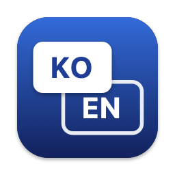

<p align="center">
  
</p>

<h1 align="center">HanYoung</h1>

<p align="center">Caps Lock 한 키로, 씹힘 없이 바로 바뀌는 macOS 한영 전환</p>

---

## 기능

| | |
|---|---|
| **짧게 누르기** | 한영 전환. 키를 떼기 전, 누르는 순간 바뀝니다 |
| **길게 누르기** (0.5초) | 영문으로 돌아가 대문자(Caps Lock)를 켜고 끕니다 |
| **메뉴바** | 현재 입력 소스를 `KO` / `EN` 배지로 표시. 한국어·영어 선택, 활성화, 로그인 시 시작 |

macOS 기본 입력기 메뉴바 아이콘과 한영 전환 단축키(Control+Space 등)는 HanYoung이 실행되는 동안만 바뀌고, 종료하면 원래대로 돌아옵니다.
앱을 지울 때는 먼저 메뉴바에서 **종료**한 뒤 지워야 원래 설정이 복원됩니다.

## 설치

### 다운로드

1. [Releases](https://github.com/Jay-lol/HanYoung/releases/latest)에서 `HanYoung-<버전>.zip`을 받아 압축을 풉니다.
2. `HanYoung.app`을 **응용 프로그램** 폴더로 옮기고 실행합니다.
3. Apple 개발자 인증서가 없는 앱이라 처음엔 macOS가 막습니다. 시스템 설정 → 개인정보 보호 및 보안 → 아래쪽 **"그래도 열기"**를 누르세요.
   터미널로는 `xattr -dr com.apple.quarantine /Applications/HanYoung.app`

### 소스에서 빌드

macOS 13 이상, Xcode (또는 Command Line Tools) 필요.

```sh
git clone https://github.com/Jay-lol/HanYoung.git
cd HanYoung
./build.sh install
```

**처음 실행할 때**

1. 손쉬운 사용 권한을 허용합니다. 시스템 설정 → 개인정보 보호 및 보안 → 손쉬운 사용 → HanYoung 켜기
2. 메뉴바 아이콘 → **로그인 시 시작**을 체크합니다.
3. Karabiner 같은 다른 도구로 Caps Lock을 바꿔뒀다면 꺼주세요.

## 문제 해결

| 증상 | 해결 |
|---|---|
| 메뉴바 아이콘이 흐리게 보임 | 손쉬운 사용 권한이 없는 상태입니다. 메뉴의 "⚠️ 손쉬운 사용 권한 필요"에서 허용하세요 |
| 다시 빌드한 뒤 동작하지 않음 | ad-hoc 서명이라 설치할 때마다 권한을 다시 허용해야 합니다 |
| `Failed to build module 'AppKit'` 빌드 오류 | Command Line Tools와 macOS 버전이 맞지 않는 경우입니다. Xcode를 설치하거나 Command Line Tools를 업데이트하세요 |
| 기본 입력기 아이콘을 다시 보고 싶음 | 시스템 설정 → 키보드 → 입력 소스 → "메뉴 막대에서 입력 메뉴 보기" |

## 동작 원리

1. 모든 키보드의 Caps Lock을 HID `UserKeyMapping`으로 **F19**에 매핑합니다. 새로 연결한 키보드에도 다시 적용하고, 종료하면 해제합니다.
2. 시스템 단축키 "이전 입력 소스 선택"을 **fn+F19**로 설정합니다. 원래 단축키는 저장해 두었다가 종료·비활성화 시 되돌립니다.
3. 이벤트 탭에서 F19 누름을 가로채 **즉시** 전환 신호를 보냅니다. macOS 기본 동작처럼 키를 뗄 때까지 기다리지 않아서, 빠르게 입력해도 첫 글자가 이전 언어로 들어가지 않습니다.

<details>
<summary>macOS 26에서 확인한 점</summary>

- 누름·뗌 신호를 1ms 간격으로 붙여 보내면 macOS가 단축키로 받지 않습니다. 그래서 뗌 신호를 30ms 뒤에 보냅니다.
- HID 매핑으로 바뀐 F19 이벤트에는 fn 플래그가 붙어 옵니다. 수식키 없는 F19 단축키로는 영어→한글 전환이 되지 않아 fn+F19로 등록합니다.

</details>

## 프로젝트 구조

```
Sources/
├── App/main.swift                 앱 시작, 각 부분 연결
├── Keyboard/
│   ├── KeyMapping.swift           Caps Lock→F19 매핑, 시스템 단축키
│   └── Switcher.swift             이벤트 탭, 전환 신호, 길게 눌러 대문자
├── InputSource/InputSource.swift  현재 입력 소스, 한/영 선택, 기본 입력기 아이콘
├── Menu/StatusMenu.swift          KO/EN 배지, 메뉴바 메뉴
└── Bridge.h                       IOKit HID 헤더
Resources/                         Info.plist, AppIcon.icns
Tools/IconGenerator.swift          앱 아이콘 생성
build.sh                           빌드 (install: 설치 후 실행, release: 배포용 zip)
```

## 라이선스

[MIT](LICENSE)
